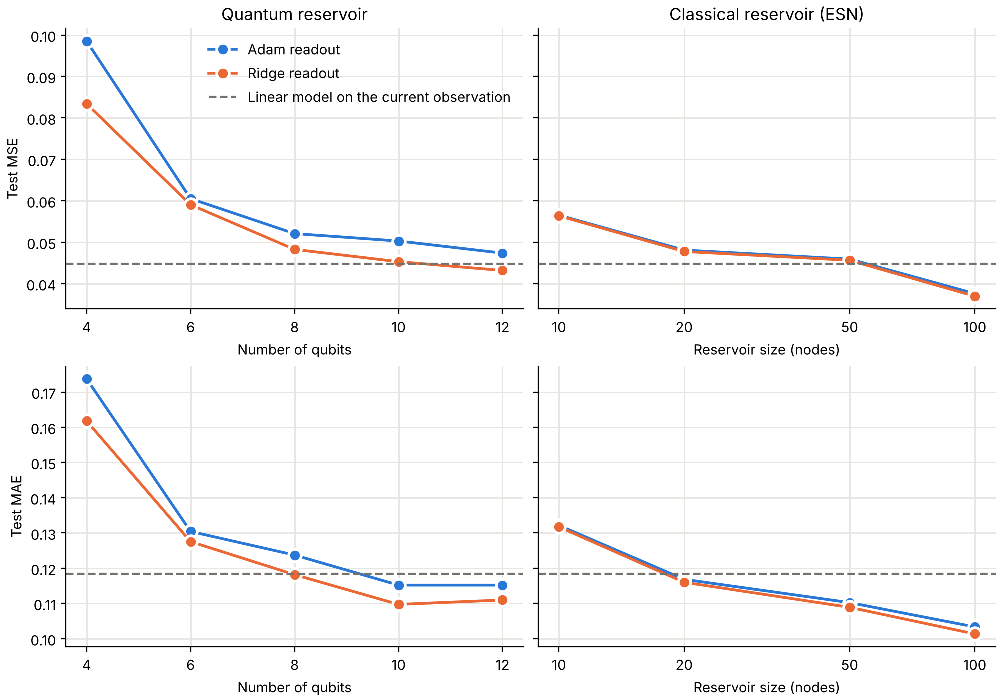
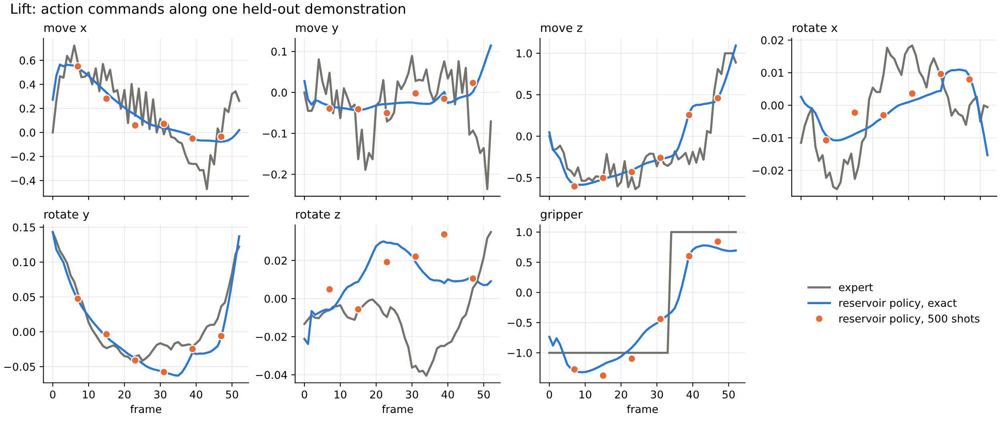

# Quantum reservoir computing for robot motion prediction

A trapped-ion-style quantum reservoir computer used as the memory of a robot controller. The reservoir is
benchmarked against classical baselines on a robot manipulation task, and the trained controller runs as
Qiskit circuits on Qollab's simulators. Press **Run** to replay a held-out human demonstration through the
trained controller; *How to run it* and *What to expect* below explain the output.

Everything here is offline prediction: the controller is scored on how closely it reproduces a human
operator's recorded actions from the recorded observations. It was not run in the robot simulator, so its
predictions never change what it sees next, and nothing here shows that it lifts the cube.

**Team:** Marcus Demierre, Juan Rodriguez Hernandez and Krystifer Campos.

This effort is supported by Qollab & IonQ.

## Introduction

### Quantum reservoir computing

Reservoir computing is a way to learn from time-dependent data, such as time series, signals or control tasks. The input sequence drives a fixed dynamical system, the *reservoir*, and we only train a simple linear *readout* on top of its state. Classically, the reservoir is a random recurrent neural network called an Echo State Network (ESN). A *quantum* reservoir swaps that network for a set of interacting qubits and uses their measured expectation values as features.

First, n qubits live in a 2ⁿ-dimensional state space, so a handful of them might do the job of a much larger classical network ([Fujii and Nakajima, 2017](https://arxiv.org/abs/1602.08159), found that 5 to 7 qubits could rival recurrent networks of 100 to 500 nodes). Second, the quantum part is never trained, so there's no costly circuit optimisation. Third, the dissipation that usually hurts quantum hardware becomes useful here: it gives the reservoir its fading memory. Whether all this adds up to a real advantage is still an open question, and that's what this project sets out to test.

### The task: imitating a robot arm

We use the **Lift** task from the robomimic benchmark, where a Franka Panda robot arm picks up a cube from a table. The dataset (`low_dim_v15.hdf5`) has 200 demonstrations recorded by a human operator; this project uses the first 100 of them. At each time step, 19 numbers describe the scene: where the gripper is and how it's oriented, how open its fingers are, and where the cube is relative to the gripper. The target is the operator's action at that step, 7 numbers that say how to move and rotate the gripper and whether to open or close it. In short, the model watches the states so far and must guess what the human did next.

### Why quantum reservoirs for this dataset?

This task is a natural fit for reservoir computing. The right action depends not just on the current state but on where we are in the motion (approaching, grasping or lifting), so temporal context may help. The mapping is also partly nonlinear: the gripper command, for example, flips suddenly from "open" to "close" once the gripper reaches the cube, a jump that a weighted sum of the inputs can't reproduce. And with only 19 inputs, the problem is small enough to encode into a few qubits, which makes it a manageable proof of concept for quantum-circuit simulation.

### The reservoirs and the readout

At every time step of a demonstration, the quantum reservoir does this:

1. The 19 observations are standardised and projected to one rotation angle per qubit (RY).
2. Every qubit gets an RZ rotation, and every pair of qubits an XX rotation with a fixed random strength.
3. Every qubit loses a fraction 0.3 of its excitation (amplitude damping), which makes old inputs fade. The
   damping is built into the circuit with ancilla qubits; it is a design choice, not a model of hardware noise.
4. The averages of Z and X on every qubit, and of ZZ and XX on every pair, are the features for the readout.

The state is carried from one time step to the next within a demonstration. The classical reservoir is a
leaky echo state network: tanh nodes with fixed random connections, spectral radius 1.0 and leak rate 0.3.

For both, only the linear readout is trained, in two ways: with Adam (200 epochs, keeping the epoch with the
lowest validation loss) and by ridge regression (strength chosen on the validation demonstrations). The 100
demonstrations are split 70/15/15 into training, validation and test sets, and a demonstration never
straddles two sets. A linear model on the current observation is the reference, and the trained controller
also runs as circuits.

## Results

Test loss is the mean squared error against the human's actions on 15 held-out demonstrations (lower is better).

| Model | Features | Adam readout | Exact (ridge) readout |
|---|---|---|---|
| Classical reservoir, 10 nodes | 10 | 0.0565 | 0.0564 |
| Classical reservoir, 20 nodes | 20 | 0.0481 | 0.0478 |
| Classical reservoir, 50 nodes | 50 | 0.0459 | 0.0456 |
| Classical reservoir, 100 nodes | 100 | 0.0376 | 0.0370 |
| Quantum reservoir, 4 qubits | 20 | 0.0985 | 0.0834 |
| Quantum reservoir, 6 qubits | 42 | 0.0605 | 0.0590 |
| Quantum reservoir, 8 qubits | 72 | 0.0521 | 0.0483 |
| Quantum reservoir, 10 qubits | 110 | 0.0503 | 0.0453 |
| Quantum reservoir, 12 qubits | 156 | 0.0474 | 0.0432 |

For reference, always predicting the average action gives 0.1740 and a linear model on the current
observation gives 0.0448.



- The quantum reservoir improves steadily with size and reaches the linear model at 10 to 12 qubits.
- The 100-node classical reservoir is clearly ahead. We found no quantum advantage on this task.
- The policy in the Qollab demo gives its readout the current observation as well as the reservoir's
  features. That lowers the linear model's 0.0448 to 0.0408. Trained on features with simulated measurement
  noise it scores 0.0430, and 0.0439 when that noise is also added to the test features. The noise is an
  independent Gaussian approximation to 1,000 shots; no circuits were run for these two numbers.

Limits of these numbers: one random reservoir per size and 15 test demonstrations, so the significance of
small gaps between rows has not been established. The Adam readout has not fully converged for the quantum reservoirs. The error is measured
against the human's actions; the policy was not run in the robot simulator, so there is no success rate.

## Repository structure

There are two files called `main.py`. The one at the top is what Qollab runs. `src/main.py` is the PyTorch
training script.

```
.
├── main.py                            Qollab entry point: replays a demonstration as circuits
├── lift_policy.npz                    the trained policy and the demonstration it replays
├── requirements.txt                   what Qollab installs: NumPy and Qiskit
├── requirements_torch.txt             adds PyTorch and Matplotlib for the PyTorch scripts
├── requirements_notebook.txt          adds what the notebooks need
├── pyproject.toml, pdm.lock           project and lock files for PDM
├── LICENSE                            MIT
├── src/
│   ├── sweep.py                       the benchmark: trains both reservoirs at every size (NumPy)
│   ├── sweep_plots.ipynb              plots the benchmark
│   ├── train_readout.py               trains the policy of the demo, writes lift_policy.npz (NumPy)
│   ├── main.py                        trains one classical and one quantum reservoir (PyTorch)
│   ├── reservoirs.py                  the reservoir models for src/main.py (PyTorch, Qiskit)
│   ├── utils.py                       training and export code for src/main.py
│   ├── main_numpy.py                  scores saved parameter files (NumPy)
│   ├── reservoirs_numpy.py            NumPy copies of the reservoir models
│   ├── utils_numpy.py                 NumPy features, prediction and metrics
│   ├── video_data.py                  dataset loading, split and normalisation
│   ├── scaling_tuned.py               tuned comparison across sets of measured observables
│   ├── scaling_core_all_w2.py         the same with every one- and two-qubit observable
│   ├── reservoir_training.ipynb       training curves for one configuration
│   ├── dataset/
│   │   ├── final_dataset.pkl          the 100 demonstrations used
│   │   ├── dataset_generation.ipynb   makes final_dataset.pkl from the HDF5 file
│   │   └── low_dim_v15.hdf5           robomimic's original file (GitHub only, too large for Qollab)
│   └── results/
│       ├── sweep/                     results.json, one .npz per trained readout, size_sweep.png
│       └── qollab_run.png             upper half of the figure of a default Qollab run
└── tests/                             unit tests
```

What Qollab runs needs only NumPy and Qiskit. The main files in more detail:

| File | What it does |
|---|---|
| `main.py` | replays one held-out demonstration with the trained 6-qubit policy, first by exact simulation, then as circuits on the selected backend |
| `lift_policy.npz` | the trained policy (input weights, couplings, damping, readout) and the demonstration it replays |
| `src/train_readout.py` | trains that policy from the 6-qubit reservoir of `sweep.py`, with a readout made robust to measurement shot noise, and saves `lift_policy.npz` |
| `src/sweep.py` | trains the classical and quantum reservoir readouts at every size; resumable, results go to `src/results/sweep/results.json` |
| `src/reservoirs_numpy.py` | the echo state network and the density-matrix quantum reservoir, in NumPy |
| `src/utils_numpy.py` | feature extraction, prediction and metrics, in NumPy |
| `src/video_data.py` | loading, validation, split, normalisation and metrics for the demonstration data |

## How to run it

### On Qollab

Open the project, choose the Built-in simulator or an IonQ simulator, and press **Run**. Nothing has to be
installed or configured. The Run settings are optional:

| Setting | Default | What it does |
|---|---|---|
| `shots` | 500 | how many times each circuit is run; the readout was trained for the noise of 1,000 shots |
| `replay` | 6 | how many past frames each circuit replays to rebuild the reservoir's memory (2 on IonQ backends) |
| `every` | 8 | every 8th frame of the demonstration is measured on the backend |
| `retrain` | off | also trains the reservoirs and the policy again inside the run |
| `max_qubits` | 6 | the largest quantum reservoir that `retrain` trains |

### On your own computer

Download or clone the repository, then:

```
pip install -r requirements.txt      # NumPy and Qiskit; use requirements_torch.txt for the PyTorch scripts
cd src                               # the scripts import each other by plain name, so run them from src/
```

| To do this | Run in `src/` | Needs |
|---|---|---|
| Redo the benchmark of the Results table | `python sweep.py` | NumPy |
| Redraw its figure | `sweep_plots.ipynb` | NumPy, Matplotlib, Jupyter |
| Retrain the policy of the Qollab demo | `python train_readout.py` | NumPy |
| Score two saved parameter files | `python main_numpy.py` | NumPy |
| Train one configuration with PyTorch | `python main.py` | PyTorch, Qiskit |
| Plot its training curves | `reservoir_training.ipynb` | PyTorch, Qiskit, Matplotlib, Jupyter |
| Compare tuned reservoirs across observable sets | `python scaling_tuned.py` | PyTorch, Qiskit, Matplotlib |
| The same with every one- and two-qubit observable | `python scaling_core_all_w2.py` | PyTorch, Qiskit, Matplotlib |
| Rebuild the dataset file | `dataset/dataset_generation.ipynb` | h5py, pandas, Jupyter |
| Run the unit tests | `python -m unittest tests.test_numpy tests.test_variable_videos`, from the top folder | NumPy |

`sweep.py` saves after every run and skips runs that are already in `src/results/sweep/results.json`, so
delete that folder to start again. The two scaling scripts take hours: set `QUICK = True` at the top of
`scaling_tuned.py`, or pass `--quick` to `scaling_core_all_w2.py`, for a short test first.

## What to expect

### From the Qollab run

A default run on the Built-in simulator prints this (shortened):

```
Demonstration with 53 frames, 6 reservoir qubits, damping 0.3
Exact reservoir policy vs expert on this demonstration: MSE 0.0411, MAE 0.1108

Running 12 circuits of 7 qubits on the backend ...
Backend: 500 shots per circuit, last 6 frames replayed per circuit
frame    action   expert    exact  same circuit  measured
    7    move z    -0.48    -0.58         -0.58     -0.61
    7   gripper    -1.00    -1.30         -1.32     -1.27
  ...
   47    move z     0.81     0.46          0.46      0.46
   47   gripper     1.00     0.73          0.74      0.84
Measured vs exact simulation of the same circuits, mean squared difference: 0.0022
Replaying 6 frames vs the full history, mean squared difference: 0.0000

Benchmark. What was run: src/sweep.py (NumPy, offline) with these settings
  ... the settings block of src/sweep.py

What it gave (stored results): test MSE and MAE against the expert on the 15 held-out demonstrations
model                           readout  features      selected      MSE      MAE  seconds
average action                                  0                 0.1740   0.2406
linear on observation                          19                 0.0448   0.1185
classical reservoir, 10 nodes      adam        10     epoch 177   0.0565   0.1322        0
  ... one row per reservoir size and readout
quantum reservoir, 12 qubits      ridge       156  ridge 0.0001   0.0432   0.1110     5261
Trained parameters: lift_policy.npz for the policy above, src/results/sweep/<run>_<readout>.npz for each row
```

The `measured` column and the `Measured vs exact` line change from run to run, because each circuit is sampled
500 times. In our runs that line was between 0.001 and 0.003. Everything else is the same on every run.

| Output | What it means |
|---|---|
| `Exact reservoir policy vs expert ...` | the policy, simulated exactly, against the human on this demonstration, which is the held-out demonstration with the median error. Commands run from −1 to 1, so it is off by about 0.11 on average |
| `Running 12 circuits of 7 qubits ...` | six frames are measured, each with one circuit in the Z basis and one in the X basis. A circuit has the 6 reservoir qubits and one ancilla for the damping |
| `expert` | what the human did; `move z` is up and down, and for `gripper` −1 is open and +1 is closed |
| `exact` | the policy, simulated exactly with the full history |
| `same circuit` | an exact simulation of the shortened circuit that was sent |
| `measured` | the policy recomputed from the counts measured on the backend |
| `Measured vs exact simulation of the same circuits ...` | how far the backend is from an exact simulation. On the Built-in simulator that is shot noise only; the IonQ simulators also apply a noise model of the device |
| `Replaying 6 frames vs the full history ...` | what is lost by replaying only the last 6 frames: about 0.00003 for the frames of this demonstration, which prints as 0.0000 |
| `Benchmark. What was run ...` | the settings of the offline benchmark, printed from `src/sweep.py` itself |
| `What it gave (stored results) ...` | the stored benchmark: the Results table with MAE, the selected epoch or ridge strength, and the offline run time |

The figure has two halves. The upper half shows the seven commands along the demonstration: the human in
grey, the exact policy in blue, and the actions recomputed from the measured circuits as orange dots. The
lower half is the size-sweep figure of the Results section.



On an IonQ simulator the run sends a single circuit of 24 qubits that uses fresh ancillas in place of reset,
because those backends accept one job per run. The table then has one frame (frame 31), each panel has one
orange dot, and the last line reads `Replaying 2 frames vs the full history, mean squared difference: 0.0016`.
We ran it on the IonQ Forte 1 simulator, which applies IonQ's noise model of that device: the job took 39
seconds, and `Measured vs exact` read 0.0012 and 0.0031 in two runs.

With `retrain` ticked the run also prints `Retraining 6 reservoirs now ...` with the seconds per reservoir
(about 7 seconds in total up to 6 qubits), the results table again for the retrained models, and
`Largest difference between the retrained and the stored test MSE: 5.6e-16`. It then retrains the policy of
the demo and prints `Largest difference between its readout weights and the ones this run started with:
1.8e-14`. Black rings in the figure mark the retrained points.

### From the scripts

| Script | What it prints | What it writes |
|---|---|---|
| `sweep.py` | a line per run, then every trained readout sorted by validation loss, with the test losses of the Results table | `results/sweep/results.json` and one `.npz` per run and readout |
| `sweep_plots.ipynb` | the size-sweep figure | `results/sweep/size_sweep.png` |
| `train_readout.py` | a table of five readouts (below) | `lift_policy.npz` at the top of the repository |
| `main_numpy.py` | `ESN: MSE=0.0375987, MAE=0.103357` and `Quantum: MSE=0.0605246, MAE=0.130437`, the 100-node and 6-qubit Adam rows of the benchmark | nothing |
| `main.py` | the losses after every epoch, then validation and test scores of both models | `results/results.json` and two `.npz` files |
| `scaling_tuned.py` | progress for every tuned point | figures, `tuned_points.json` and `tuned_points.csv` in `results/scaling_tuned/` |
| `scaling_core_all_w2.py` | progress for every qubit number | a figure and `tuned_params.json` in `results/scaling_core_all_w2/` |
| the unit tests | `Ran 22 tests` and `OK` | nothing |

**Note:** `scaling_tuned.py` and `scaling_core_all_w2.py` (GitHub only) are tuning studies that compare the quantum reservoir with the ESN as both grow. `scaling_tuned.py` tunes every model per size (2–6 qubits, 5–300 neurons) for five sets of measured observables, using a fast simulator checked against the Qiskit reservoir. `scaling_core_all_w2.py` repeats the study for the best set (all one- and two-qubit Paulis) up to 8 qubits with wider parameter ranges, running the Qiskit reservoir directly, and saves the tuned parameters per qubit number to a JSON file. Both need PyTorch and Qiskit.

`train_readout.py` prints:

```
100 demonstrations (70/15/15), 4699 frames

readout on                                             inputs   ridge  test loss  at 1000 shots
nothing (the average action)                                0   1e-08     0.1740
current observation                                        19      10     0.0448
reservoir features                                         42    0.01     0.0590
observation + reservoir features                           61     0.1     0.0408
observation + reservoir features, trained with noise       61       1     0.0430         0.0439

Saved lift_policy.npz: readout weights up to 0.99, a demonstration of 53 frames to replay
```

The last row is the policy that Qollab runs. The column `at 1000 shots` is the test loss with simulated
measurement noise added to the features, not a measurement of circuits.

On a laptop the benchmark took 1 to 3 seconds per reservoir up to 6 qubits, 22 seconds for 8 qubits, about
5 minutes for 10 and 88 minutes for 12. `train_readout.py`, `main_numpy.py` and the unit tests finish in
seconds.

`src/main.py` has its own settings at the top of the file, and they differ from the benchmark's: 100 epochs,
spectral radius 0.9 and Jz = 10, against 200, 1.0 and 3. Its scores will therefore not be the rows of the
Results table.

## How it was checked

- The simulation in `sweep.py` gives the same features as `reservoirs_numpy.QuantumReservoir` to 13 decimal
  places, and the same test scores as a parameter file exported by an earlier version of `src/main.py` to 9 decimal
  places.
- The fast simulation in `scaling_tuned.py` gives the same results as the Qiskit reservoir in
  `src/reservoirs.py` to 7 decimal places on a reduced run.
- On Qollab, the actions recomputed from measured counts match an exact simulation of the same circuits to a
  mean squared difference of 0.001 to 0.003 at 500 shots, on the Built-in simulator and on the IonQ Forte 1
  simulator, which includes IonQ's noise model.
- Retraining inside a Qollab run (up to 6 qubits) gives the stored test scores back to within 1e-15.
- `python -m unittest tests.test_numpy tests.test_variable_videos` runs the NumPy tests from the top folder.

## Extend it

- **Other sizes, seeds or settings.** Every setting written as a list in `ESN_CONFIG` or `QUANTUM_CONFIG` at
  the top of `src/sweep.py` is swept, for example `"num_qubits": [4, 6, 8]` or `"seed": [42, 1, 2]`. Use a
  new `RESULTS_DIR` after changing a setting that is not swept.
- **Other observables or couplings.** `single_observables`, `pair_observables` and `interaction` (`"XX"`,
  `"YY"` or `"ZZ"`) are settings of `QUANTUM_CONFIG`. The Qollab circuits are written for the default
  reservoir, and `train_readout.py` checks for it.
- **Another task.** Save its demonstrations in the format of `final_dataset.pkl` (see *Dataset files*) and
  point `DATASET_PATH` at it. The numbers of observations and actions are read from the data.
- **A success rate.** The policy was not run in the robot simulator. Rolling it out in robosuite would turn
  the error against the human into a success rate.

The rest of this page documents the data and the training code in detail.

## Input Data

### Source: robomimic Lift (Proficient-Human), `low_dim_v15.hdf5`

The data comes from robomimic, a framework and benchmark for robot learning from demonstration developed by the Stanford Vision and Learning Lab as part of the ARISE Initiative. 

| | |
|---|---|
| Library | robomimic, <https://github.com/ARISE-Initiative/robomimic> |
| Dataset documentation | <https://robomimic.github.io/docs/v0.3/datasets/robomimic_v0.1.html> |
| Task | **Lift**: a Franka Panda robotic arm grasps a small cube on a table and lifts it |
| Demonstrator type | **Proficient-Human (PH)**: one experienced operator teleoperating the robot via RoboTurk; 200 successful demonstrations |
| File used | `lift/ph/low_dim_v15.hdf5` (low-dimensional observations, no images) |
| File size | ~21 MB |

**Reference.** If you use this dataset, please cite the original robomimic paper:

> A. Mandlekar, D. Xu, J. Wong, S. Nasiriany, C. Wang, R. Kulkarni, L. Fei-Fei, S. Savarese, Y. Zhu, and R. Martín-Martín, "What Matters in Learning from Offline Human Demonstrations for Robot Manipulation," *Conference on Robot Learning (CoRL)*, 2021. [arXiv:2108.03298](https://arxiv.org/abs/2108.03298)

**Version note.** The demonstrations were recorded in the robosuite simulator (MuJoCo physics), environment version 1.5.1, as stored in the file's env_args metadata. This is why the file is named `low_dim_v15.hdf5` rather than the `low_dim_v141.hdf5` listed on the v0.3 documentation page. Neither robomimic nor robosuite is a runtime dependency of this project: they were used only to obtain and inspect the original file, and the pipeline reads it directly with h5py.


### Licensing

| Component | Role in this project | License |
|---|---|---|
| robomimic (ARISE-Initiative/robomimic) | Source of the Lift PH dataset and its format | MIT |
| robosuite (ARISE-Initiative/robosuite) | Simulator that generated the demonstrations | MIT |

### Original file structure (HDF5)

Besides arrays, HDF5 groups can carry small **metadata attributes** (marked "metadata:" in the tree). They describe the group itself rather than holding training data. This project only reads `env_args`, to confirm the task is `"Lift"`.

```
low_dim_v15.hdf5
├── data/                      metadata: environment settings (env_args, JSON text),
│   │                                    total time steps across all demos (total = 9666)
│   ├── demo_0/                metadata: time steps in this demo (num_samples = T),
│   │   │                                MuJoCo scene description (model_file, XML text)
│   │   ├── obs/               observations at time t
│   │   │   ├── robot0_eef_pos          (T, 3)
│   │   │   ├── robot0_eef_quat         (T, 4)
│   │   │   ├── robot0_gripper_qpos     (T, 2)
│   │   │   ├── object                  (T, 10)
│   │   │   ├── robot0_eef_quat_site    (T, 4)    ┐
│   │   │   ├── robot0_gripper_qvel     (T, 2)    │
│   │   │   ├── robot0_joint_pos        (T, 7)    │ present in the file,
│   │   │   ├── robot0_joint_pos_cos    (T, 7)    │ NOT used in this project
│   │   │   ├── robot0_joint_pos_sin    (T, 7)    │
│   │   │   └── robot0_joint_vel        (T, 7)    ┘
│   │   ├── next_obs/          same keys, shifted by one step (obs at t+1)
│   │   ├── actions            (T, 7)
│   │   ├── rewards            (T,)
│   │   ├── dones              (T,)
│   │   └── states             (T, 32)   full MuJoCo simulator state
│   ├── demo_1/
│   ├── ...
│   └── demo_199/
└── mask/                      predefined train/validation splits (lists of demo names)
    ├── train (180)            valid (20)
    ├── 50_percent (100)       50_percent_train (90)   50_percent_valid (10)
    └── 20_percent (40)        20_percent_train (36)   20_percent_valid (4)
```

Each demo is an independent episode with its own length `T`. The listing below shows a few demos and the arrays used by this project:

```
demo_1:   58 time steps | robot0_eef_pos (58, 3), robot0_eef_quat (58, 4), robot0_gripper_qpos (58, 2), object (58, 10), actions (58, 7)
demo_10:  54 time steps | robot0_eef_pos (54, 3), robot0_eef_quat (54, 4), robot0_gripper_qpos (54, 2), object (54, 10), actions (54, 7)
demo_100: 47 time steps | robot0_eef_pos (47, 3), robot0_eef_quat (47, 4), robot0_gripper_qpos (47, 2), object (47, 10), actions (47, 7)
demo_101: 43 time steps | robot0_eef_pos (43, 3), robot0_eef_quat (43, 4), robot0_gripper_qpos (43, 2), object (43, 10), actions (43, 7)
demo_102: 58 time steps | robot0_eef_pos (58, 3), robot0_eef_quat (58, 4), robot0_gripper_qpos (58, 2), object (58, 10), actions (58, 7)
```

### Variables used

#### Inputs: 19 features per time step (robot and object state)

| HDF5 key | Dim | Column names | Meaning |
|---|---|---|---|
| `robot0_eef_pos` | 3 | `eef_x, eef_y, eef_z` | End-effector (gripper) position in the world frame [m] |
| `robot0_eef_quat` | 4 | `eef_qx, eef_qy, eef_qz, eef_qw` | End-effector orientation as a unit quaternion (x, y, z, w) |
| `robot0_gripper_qpos` | 2 | `finger_1, finger_2` | Positions of the two finger joints [m]. They are approximately mirror images (`finger_2 ≈ −finger_1`); values range from about 0.02 to 0.04 in magnitude |
| `object[0:3]` | 3 | `cube_x, cube_y, cube_z` | Cube position [m] |
| `object[3:7]` | 4 | `cube_qx, cube_qy, cube_qz, cube_qw` | Cube orientation as a quaternion |
| `object[7:10]` | 3 | `grip2cube_x, grip2cube_y, grip2cube_z` | Relative vector from the gripper to the cube. Checked numerically to equal `cube_pos − eef_pos` exactly |

#### Targets: 7 values per time step (the operator's action)

| Column | Meaning | Range in the data |
|---|---|---|
| `act_dx, act_dy, act_dz` | Commanded end-effector translation, normalized to [−1, 1] (±1 maps to ±5 cm per step) | [−1, 1] |
| `act_drx, act_dry, act_drz` | Commanded end-effector rotation (axis-angle), normalized to [−1, 1] (±1 maps to ±0.5 rad per step) | about [−0.39, 0.47] in the 100 demonstrations used |
| `act_grip` | Gripper command: −1 = open, +1 = close | exactly {−1, +1} (binary) |

The learning problem is therefore **behavior cloning as sequence regression**: given the state sequence up to time *t*, predict the action the human took at time *t*. The gripper target is binary, while the other six are continuous.

**Redundancy note.** Some inputs are redundant: `grip2cube_*` is an exact linear combination of `cube_*` and `eef_*`, and the two finger coordinates are nearly mirror images. This means the 19 inputs carry fewer than 19 independent degrees of freedom. 

### From HDF5 to nested lists (`dataset_generation.ipynb`)

The notebook `dataset_generation.ipynb` (needs `h5py`, `numpy`, `pandas`) turns the HDF5 file into plain Python nested lists, keeping each demo at its own length with no padding. It loads the first 100 of the 200 Lift demos (`N_DEMOS = 100`), joins the four observation groups into 19 inputs per time step, and pairs each step with the 7-value action the operator took at that same step. After checking that every demo is consistent (matching lengths, no missing values), it saves the lists, column names and demo names to a pickle file (`final_dataset.pkl`, next to the HDF5 file).

#### Resulting structure

```
inputs  = [video_1, video_2, ..., video_N]        # one element per demo (N = 100)
video_i = [time_steps, values]
    time_steps = [1, 2, ..., T_i]                 # T_i in [36, 59], differs per demo
    values     = [[19 floats at step 1],
                  [19 floats at step 2],
                  ...]                            # T_i rows

targets = [video_1, ..., video_N]                 # same structure, 7 floats per step

input_keys  = ["eef_x", "eef_y", "eef_z", "eef_qx", ..., "grip2cube_z"]   # 19 names
target_keys = ["act_dx", "act_dy", "act_dz", "act_drx", "act_dry", "act_drz", "act_grip"]
demo_names  = ["demo_0", "demo_1", ...]
```

Example (`demo_0`, 59 steps, first time step):

```
t = 1
inputs : [-0.0905, -0.0152, 1.0118, 0.9972, -0.0072, 0.0740, 0.0019, 0.0208, -0.0208,
           0.0264,  0.0270, 0.8314, 0.0000,  0.0000, 0.9691, 0.2466, 0.1169,  0.0422, -0.1804]
targets: [-0.0, 0.0, 0.0, 0.0038, 0.1482, 0.0145, -1.0]
```

## Video inputs and decision targets

In the code and in the sections below, a demonstration is called a video, a time step a frame, and the 7
action values a decision vector.

Videos can have different frame counts. Pass them as lists of NumPy arrays:

```python
X = [video_0, video_1, video_2]       # Each array: (frames_i, features)
y = [target_0, target_1, target_2]    # Each array: (frames_i, decision_vector)
```

`X[i]` and `y[i]` must have the same frame count. All input videos share one
feature width, and all targets share one decision-vector width. These widths
can differ. Every video must contain at least one frame.

For frame `t`, the model observes frames `0..t` and predicts `y[i][t]`.
State resets between videos. Equal-length videos are grouped internally for
batching, and outputs are restored to the original video order. No padding is
used. MSE and MAE average across all actual frame coordinates, so longer videos
contribute more frames to the overall score.

Regular arrays `(N,T,features)` and `(N,T,decision_vector)` still work.
Predictions match the input form: a dense array for dense inputs, or a list of
`(frames_i, decision_vector)` arrays for list inputs.

## Dataset files

Training and NumPy evaluation load `src/dataset/final_dataset.pkl` by default.
The notebook `src/dataset/dataset_generation.ipynb` saves this file next to its
source HDF5 dataset. It contains:

```python
{
    "inputs": [[time_steps, input_values], ...],
    "targets": [[time_steps, action_values], ...],
    "input_keys": [...],
    "target_keys": [...],
    "demo_names": [...],
}
```

`video_data.load_dataset` extracts each video's numeric value matrices and
checks matching time steps. The time-step lists are metadata, not model inputs.
Video counts, frame counts, and vector widths come from the saved dataset.
Training prints these dimensions when loading it.

For other datasets, the utility functions also support `.npz` archives with one numeric array per video,
keyed `video_000000`, `video_000001`, and so on. They load without pickle:

```python
from video_data import save_videos, load_videos

save_videos("features.npz", X)
save_videos("decision_targets.npz", y)
X = load_videos("features.npz")
y = load_videos("decision_targets.npz")
```

`load_videos` also accepts older dense `.npy` files. Load these yourself and pass
the resulting `X, y` arrays to the entry points. The input and target archives
must use the same video order.

## Train and export

Install `requirements_torch.txt` in the training environment. Configure paths and
model settings at the top of `src/main.py`, then run it in your editor or call:

```python
from main import main as train

models, metrics = train(X, y)
```

Calling `train()` without arguments loads `src/dataset/final_dataset.pkl`.
Set `DATASET_PATH` in `src/main.py` to use another notebook-format pickle.
The script splits by video into 70% training, 15% validation, and 15% test sets.
The 100 videos here give 70/15/15. Frames from a video stay in one split.

Only `w_out` and its bias are trained with Adam, minimizing MSE. Reservoir
features and aligned targets are cached once per split over real frames.
Set `EPOCHS`, `LEARNING_RATE`, `ADAM_BETAS`, `ADAM_EPS`, `BATCH_SIZE`, and `SEED`
at the top of `src/main.py`. Validation and test targets are excluded from updates.

`loss` means mean squared error: the average of `(prediction - target)**2`.
MAE is the average absolute error and is reported alongside the loss; Adam
optimizes MSE. Both metrics compare predictions with the imported decision
targets at the same frame, in their original units.

Inputs are standardized per feature using the mean and standard deviation of
real training frames only. Constant features use a scale of 1. Both reservoirs
use these same statistics. Set `ESN_INPUT_GAIN` and `QUANTUM_INPUT_GAIN` to control
the strength of the standardized signal; the quantum gain controls input rotation
angles. `INPUT_STD_EPS` sets the threshold for treating a feature as constant.
Targets keep their original units.

Standardization and gain are folded into the fixed input weights and bias.
Always pass raw inputs to training and prediction, including direct model calls;
do not standardize them again. Each checkpoint saves `input_mean`, `input_std`,
and `input_preprocessing` metadata, also recorded in the results JSON. NumPy
evaluation uses the exported projection directly. Retrain existing models to
use the new preprocessing.

Training prints training/validation MSE and MAE at epoch 0 and after every epoch.
The weights with the lowest validation MSE are restored before scoring the test
split once. Epoch 0 can be selected if training does not improve validation MSE.

Source files use plain imports. For interactive calls, add `src/` to your
Python import path or open your interpreter there. Running `src/main.py` directly
from your editor also works.

Training saves two named checkpoints and one shared benchmark file directly under
`src/results/`. With the default settings:

```text
results/
  esn_size_100_leak_rate_0.3.npz
  qr_n_6_hz_1.0_jz_10_leak_rate_0.3.npz
  results.json
```

Each `.npz` contains fitted readouts, fixed reservoir parameters, and the model
configuration. Both checkpoints also retain `num_qubits`, `hz`, `Jz`, and
`leak_rate` as scalar arrays and in their JSON metadata. Quantum `damping` uses
`leak_rate`.

`results.json` contains entries for `Classical ESN` and `Quantum`, each with
`params` (model settings, split seed, and Adam settings), `best_epoch`, and final
`validation` and `test` benchmarks with MSE (`loss`) and MAE. Adam settings are
also recorded in the checkpoint metadata. A run saves only these three files;
the shared JSON describes the latest run.

## Evaluate with NumPy only

Install NumPy in the evaluation environment. By default `ESN_PARAMS` and `QUANTUM_PARAMS`
point at two files of the size sweep in `src/results/sweep/`. Copy the selected `.npz` checkpoints
and dataset to the evaluation machine. Set `ESN_PARAMS` and `QUANTUM_PARAMS` in
`src/main_numpy.py` to the chosen `.npz` files. Set `DATASET_PATH` there to
the same `final_dataset.pkl`. It loads the original dataset
and recreates the test split using the same NumPy shuffle and `SEED` as training:

```python
from main_numpy import main as evaluate

predictions, metrics = evaluate()
```

For independent evaluation files, set `USE_TEST_SPLIT = False` to evaluate every
video. Or supply another dataset directly; supplied videos are always evaluated
in full:

```python
predictions, metrics = evaluate(X, y)
esn_predictions = predictions["ESN"]
quantum_predictions = predictions["Quantum"]
# For list input: esn_predictions[i].shape == (len(X[i]), decision_vector).
```

Paths and `BATCH_SIZE` are configured at the top of `src/main_numpy.py`; there
are no command-line arguments. Paths are based on the script's directory and
work independently of the current working directory.

Evaluation imports neither PyTorch nor Qiskit. Both NumPy reservoirs accept
video lists directly through `model(X)`. Use `utils_numpy.predict` for
batching and `utils_numpy.evaluate(model, X, y)` for metrics.
`utils_numpy.reservoir_features` also accepts video lists. Training happens in
`main.py`; NumPy inference applies the exported readout through matrix multiplication.

The quantum reservoir uses NumPy density matrices for input encoding, Ising
evolution, observable measurement, and damping. State memory scales as
`batch_size * 4**num_qubits`; use small qubit counts and bounded batches.
Float32 training and float64 inference may differ slightly due to rounding.

Existing model `.npz` checkpoints remain compatible. Run training again to
create the named checkpoints and shared benchmarks. Older runs used a Torch
shuffle; the recreated NumPy test split applies to new runs.

## Reservoir state and streaming

Each batch row has its own reservoir state. For a batch of complete videos,
state is initialized once before the first frame, carried through all frames
and internal steps, then cleared when the call finishes. It is never reset
between frames or predictions within that video. Independent videos start
from fresh states.

Training computes these sequences once when caching reservoir features.
Subsequent Adam batches and epochs update the readout using the cached features;
they do not rerun or reset the reservoir dynamics.

For streaming, call a loaded model with one frame per stream, shaped
`(batch_size, features)`:

```python
from reservoirs_numpy import load_model
from main_numpy import ESN_PARAMS

model = load_model(ESN_PARAMS)  # The same interface works for a quantum checkpoint.
model.initialize(len(X))       # X is a dense (N, T, features) array here.
for t in range(X.shape[1]):
    prediction = model(X[:, t, :])  # Shape: (N, decision_vector); state persists.
```

Keep the batch size and stream order fixed until calling `initialize` for new
videos. Passing `(N, 1, features)` instead invokes complete-video evaluation
and starts fresh state on every call. These state rules apply to both the
training and NumPy reservoir implementations.

## Proposed reservoir feature normalization

The current implementation standardizes **inputs**, as described above.
It does not yet standardize the measured quantum features or the ESN states
before the readout. Quantum observables lie in `[-1, 1]`, but their variances
can differ substantially, which can make Adam optimization uneven.

An optional improvement is to standardize each reservoir feature using mean
and standard deviation fitted on actual training frames only. Use those frozen
statistics for validation, test, and streaming, with a scale of 1 for nearly
constant features. Apply this after measurement and before `w_out`, so it
does not change reservoir evolution or memory. Compare enabled and disabled
normalization for both models; it may help optimization but adds no information
to the features.

If implemented, normalization can be folded into the exported readout. For a
trained weight matrix `W` shaped `(decisions, reservoir_features)`:

```python
W_export = W / feature_std[None, :]
b_export = b - W_export @ feature_mean
# Inference on unnormalized reservoir features:
prediction = features @ W_export.T + b_export
```

This would preserve NumPy inference through matrix multiplication and bias
addition. These readout transformations are a proposal, not current behavior.

## Verification

Open `src/reservoir_training.ipynb` to plot epoch versus MSE and MAE for
both reservoirs. Install `requirements_notebook.txt` in the notebook environment.
Its settings cell defines the dataset path, split fractions, seed, batch size,
Adam settings, and every ESN/quantum constructor hyperparameter. These settings
are independent of `main.py`; input and output widths come from the dataset.
It caches reservoir features once and uses the same Adam training function as
`main.py`. It plots training and validation MSE/MAE, restores the best validation
epoch, and evaluates the test split once. Histories stay in the notebook.

Run `src/reservoirs.py` in your editor to check whether both `w_out` readouts are
optimized. It uses the current settings in `main.py`, `final_dataset.pkl`, and
the same video split, without saving checkpoints or results. It prints:

- Training MSE before/after fitting and a mean-target baseline.
- Changes to readout weights and bias; whether fixed reservoir parameters stayed unchanged.
- Whether Adam reduced training MSE and changed the readout parameters.
- Validation/test MSE and PASS/FAIL for each readout.

Both models train their readout with Adam. PASS confirms parameter updates and
reduced training MSE while preserving the fixed reservoir. It does not guarantee
convergence; validation/test metrics measure performance on unseen videos.

From the project root, run `python -m unittest tests.test_numpy tests.test_variable_videos`
in a NumPy-only environment. In a training environment, also run
`python -m unittest tests.test_training_export`. The integration checks cover
dense and variable-length training, video splits, exported parameter equality,
and separate inference processes with Torch/Qiskit imports blocked.

## Credits and disclosure

- **Data:** the Lift demonstrations were recorded in the robosuite simulator and published as part of robomimic (Mandlekar et al., CoRL 2021). `final_dataset.pkl` and the demonstration stored in `lift_policy.npz` are derived from them. See *Input Data* above for the full reference and licences.
- **Libraries:** Qiskit, NumPy, Matplotlib and PyTorch.
- **Background:** Quantum reservoir computing was introduced by Fujii and Nakajima, "Harnessing
  Disordered-Ensemble Quantum Dynamics for Machine Learning", Phys. Rev. Applied 8, 024030 (2017).
- **AI assistance:** AI tools (Claude and ChatGPT) helped write and debug code and draft parts of this
  write-up. The team designed the project, ran every experiment and checked the results.
- **Build window:** All code here was written during the hackathon, 9 to 11 October 2026. 


The code is released under the MIT licence (see `LICENSE`).


